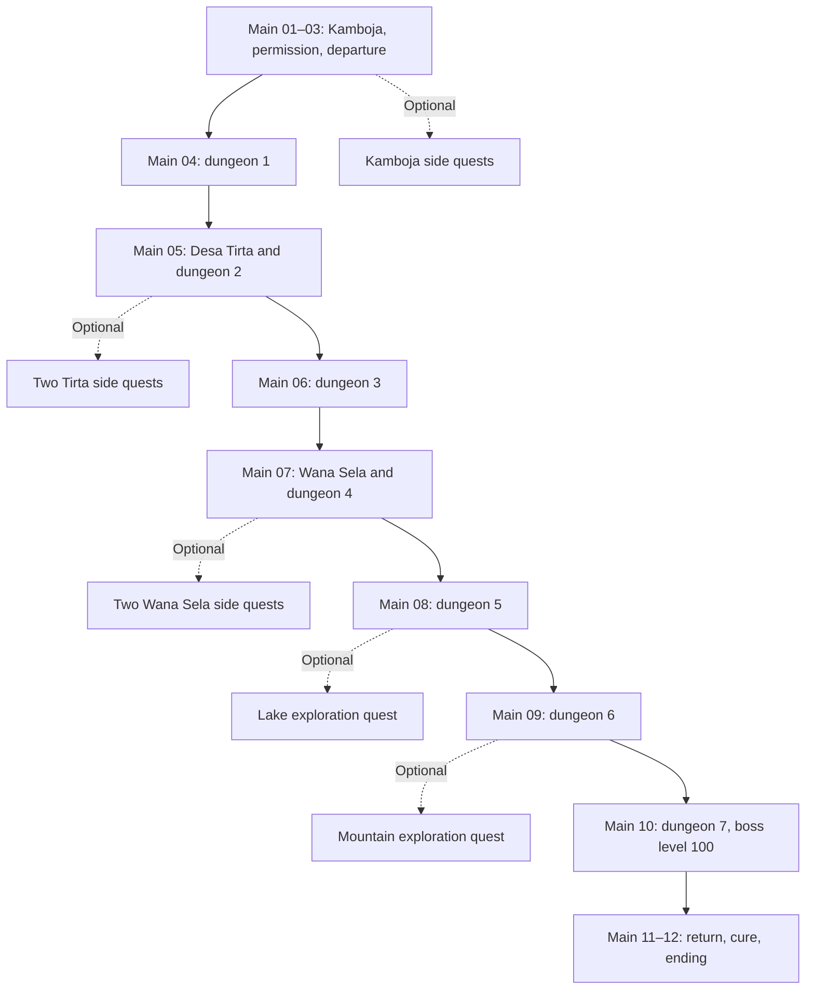

# Quest catalog and progression flow

Status: design draft, not implemented quest code. This is the authoritative quest list for the current story plan: **12 main quests and 11 optional side quests**. Stable IDs retain the main-story identifiers introduced in [main-story.md](main-story.md).

See [mainland-settlements.md](mainland-settlements.md) for the two regional hubs and [dungeon-progression.md](dungeon-progression.md) for boss levels, ingredients, and combat themes.

[Mainland island map plan](mainland-map-plan.md) places the existing quest route on a forest-and-mountain island with multiple lakes, a large southern bay, and surrounding ocean. The geography adds exploration space without changing this quest inventory or requiring sea travel.

## 1. Intended player flow

Keep one clear main objective visible. Introduce regional side quests in small groups near the route the player is already taking. The player should understand where to go next without completing every marker on the map.

The rhythm is **a brief human problem → preparation and exploration → a dungeon challenge → a guaranteed ingredient → a quieter reward or relationship moment**. Vary the human problem and dungeon structure; do not vary whether the required ingredient actually drops.

Dotted branches are optional detours; finishing them is never a prerequisite for the next main node. Optional visits home and ordinary exploration remain possible between chapters. The final return after dungeon 7 is required.

### First version content budget

- Twelve main quests, including seven dungeon quests.
- Five Kamboja side quests spread over the journey; offer only two short tasks initially.
- Two side quests in each new settlement, alongside its existing dungeon main quest.
- One exploration side quest near dungeon 5 and one near dungeon 6.
- No new side-quest chain at the final portal. Give the finale room to breathe.
- No repeatable bounty board, daily tasks, reputation grind, alternate endings, or extra medicinal ingredients in this initial scope.

## 2. Main quest list

For numbered quests below, `complete(main_XX)` means that the previous quest's required story condition is recorded, not that the player has merely accepted it. Main quests award one-time story XP; numerical XP and currency amounts remain balance work.

| ID and title | Available after | Contact / location | Required objectives and completion | Reward and next step |
| --- | --- | --- | --- | --- |
| `main_01_village` — **A Village Growing Quiet** | New game | Rukmini, Lestari, Darma / Kamboja | Reach the clinic, learn about the illness, then speak with Darma about the remedy record | Story XP; unlock preparation and the reason for the expedition |
| `main_02_permission` — **A Promise at the Door** | `main_01_village` | Lestari, Ratih, Bayu / Kamboja | Receive the journal and sealed satchel; ask Ratih's permission; speak with Bayu at the departure gate | Guaranteed basic travel supplies, permission flag, and access to the departure route |
| `main_03_departure` — **Beyond the Last Fence** | `main_02_permission` | Journal / village outskirts and Hutan Embun | Leave Kamboja; learn combat and recovery through a short, clearly marked encounter; discover portal 1 | Story XP, first portal checkpoint, and dungeon-1 objective |
| `main_04_dungeon_01` — **The First Ingredient** | `main_03_departure` | Journal / Akar Terlupakan | Traverse the dungeon; defeat Penjaga Lumut, level 12; record Daun Embun | Ingredient 1/7, boss/story XP, safe exit, and the wetland lead |
| `main_05_dungeon_02` — **A Path Above the Water** | `main_04_dungeon_01` | Sena or journal / Desa Tirta → Rawa Bisu | Follow the standing-stone lead through the raised-trail encounter; defeat Ratu Rawa, level 25; record Lumut Nadi | Ingredient 2/7, boss/story XP, safe exit, and the foothill lead |
| `main_06_dungeon_03` — **What the Mountain Keeps** | `main_05_dungeon_02` | Journal / Lereng Bara → Gua Bara | Follow the quarry route; use a miner's route note or equivalent journal hint; defeat Golem Bara, level 40; record Getah Bara | Ingredient 3/7, boss/story XP, safe exit, and the ravine lead |
| `main_07_dungeon_04` — **Beyond the Bridge** | `main_06_dungeon_03` | Sekar, Damar, or journal / Wana Sela → Jurang Angin | Reach the ravine lookout and learn the crossing route; traverse Menara Angin; defeat Rajawali Batu, level 55; record Bunga Langit | Ingredient 4/7, boss/story XP, safe exit, and the lake lead; offer Ratih's midpoint letter |
| `main_08_dungeon_05` — **The Recipe Remembered** | `main_07_dungeon_04` | Journal / Danau Senja → Kuil Senja | Discover the lakeshore ruin; find the inscription or its accessible journal summary; defeat Ular Senja, level 70; record Akar Senja | Ingredient 5/7, boss/story XP, safe exit, and the ridge lead |
| `main_09_dungeon_06` — **A Light in the Pass** | `main_08_dungeon_05` | Journal / Punggung Kabut → Benteng Kabut | Follow the marked pass; defeat Penjaga Kabut, level 85; record Biji Fajar | Ingredient 6/7, boss/story XP, safe exit, and the summit lead |
| `main_10_dungeon_07` — **Bring the Dawn Home** | `main_09_dungeon_06` | Journal / Puncak Niskala → Jantung Niskala | Reach the preparation checkpoint; defeat Jantung Kelam, level 100; record Sari Niskala | Ingredient 7/7, boss/story XP, final exit shortcut, and immediate return-home objective |
| `main_11_return` — **Seven Gifts for Kamboja** | `main_10_dungeon_07` and all seven ingredients | Ratih, Darma, Lestari / Kamboja | Return through the village entrance; reach Lestari at the clinic; confirm the complete collection | Cure preparation becomes available; quest ingredients remain protected until preparation |
| `main_12_cure` — **A Morning Restored** | `main_11_return` and all seven ingredients | Arka and Lestari / clinic and village | Complete the prompted preparation; distribute the cure through the story scene; show recovery and Arka's return home | Village cured, ending, credits, and completion save |

### Completion rules for route and conversation beats

The human contacts explain the main route; they do not become a separate reputation requirement. Approaching a hub or landmark can reveal the essential journal lead even if its optional dialogue is skipped. A lawful alternate route or early encounter must not require the player to repeat completed actions afterward.

The boss-and-ingredient milestone is authoritative for each dungeon quest. If the player has already resolved the corresponding route encounter, record that step as complete. If a valid shortcut bypasses an introductory conversation, supply its essential journal summary and reconcile the milestone rather than requiring a return trip solely for dialogue.

Each boss gives exactly one distinct medicinal ingredient. Side quests never grant one, and the cure requires all seven. Recipe knowledge comes from the main story, never from a side-quest reward or a missable optional inscription.

## 3. Side quest list

All listed side quests are one-time optional quests. “Available” means they may be offered; accepting them requires player choice. They remain available during exploration until the ending sequence starts, unless already completed. No real-time deadlines apply.

Rewards below describe their purpose, not final numeric values. Supply and equipment rewards use ordinary items; unique quest inventory is reserved for story items and task-specific objects.

### Kamboja — Home relationships

| ID and title | Giver / availability | Objective sequence | Reward and narrative payoff |
| --- | --- | --- | --- |
| `sq_kam_01` — **A Stray by the Fence** | Laras / after `main_01_village` | Find a stray goat near the safe village fence; guide it back through a short interaction; speak with Laras | Small XP award and travel food; Laras later helps clinic volunteers |
| `sq_kam_02` — **Seeds for Tomorrow** | Dewi / after `main_02_permission` | Collect a prepared seed parcel; deliver it to Jatmika in the nearby fields; hear how the illness affects planting | Small XP award and ordinary supplies; planted beds change later. Do not require gathering random monster drops |
| `sq_kam_03` — **Hands at the Clinic** | Bima / after `main_01_village` | Sort a small set of labeled supply bundles; place them on matching shelves; report to Bima | Small XP award and recovery supplies; introduces inventory interaction without consuming the seven ingredients |
| `sq_kam_04` — **A Map for Sinta** | Sinta or Mira / after `main_02_permission` | Accept the request; record three distinct major mainland landmarks during ordinary travel; show the journal to Sinta on any later home visit | Exploration XP and a classroom display that reappears in the ending; credit already discovered landmarks |
| `sq_kam_05` — **Stories for the Road** | Wening / after `main_04_dungeon_01` | Accept during a home visit; listen to Wening, Sena, and Damar at their normal locations; share the collected stories with Wening on a later visit | Modest XP and a remembrance scene; reinforces ordinary travelers' experiences without making optional lore necessary for the cure |

Offer `sq_kam_01` and `sq_kam_03` as the first short choices. Do not present a five-quest checklist before Arka can leave. The longer journal/story requests should be completed through travel the player already intends to do.

`Stories for the Road` is intentionally a long-running relationship quest, not an urgent delivery. Damar's story becomes available at the lookout or village after his main-route encounter. Prior conversations count if accepted later. Never require reopening or replaying his rescue scene.

### Desa Tirta — Wetland community

| ID and title | Giver / availability | Objective sequence | Reward and narrative payoff |
| --- | --- | --- | --- |
| `sq_tir_01` — **Water for Every Home** | Nala / discover Tirta after `main_04_dungeon_01` | Inspect the water point; follow its short supply channel; defeat a fixed group blocking maintenance access; clear debris and report | Regional side-quest XP and recovery supplies; villagers use the restored water point. This fixes access and supply, not Demam Layu |
| `sq_tir_02` — **What the River Took** | Danu / discover Tirta after `main_04_dungeon_01` | Learn where a storm scattered repair materials; recover two marked bundles along the wetland route; return them at the fishing platform | Regional side-quest XP and an ordinary supply pouch or equivalent consumable bundle; fishing activity resumes |

Both tasks branch from the same general approach used by `main_05_dungeon_02`. Neither requires entering an uncleared dungeon or paying for access to its portal. Returning from the dungeon is a natural opportunity to turn them in.

Suri provides normal restocking immediately on discovery. Her stock must not depend on restoring the water point or finding Danu's bundles.

### Desa Wana Sela — Work and shelter

| ID and title | Giver / availability | Objective sequence | Reward and narrative payoff |
| --- | --- | --- | --- |
| `sq_wan_01` — **Tools Left Behind** | Wira / discover Wana Sela after `main_06_dungeon_03` | Inspect a damaged supply cart near the foothill-ravine junction; recover its marked tool crate from a small encounter; return it | Regional side-quest XP and a repair discount or alternative equipment option; forge activity resumes |
| `sq_wan_02` — **Shelter at the Pass** | Intan / discover Wana Sela after `main_06_dungeon_03` | Take a prepared repair bundle; restore two marked wayfinding posts on the main approach; open a resting shelter via a short interaction; report | Regional side-quest XP, supplies, and a convenient shelter shortcut; carriers gain a safer rest stop |

Normal repairs and equipment sufficient for the story remain available before `Tools Left Behind`. The shelter is additional convenience, not the only checkpoint, the only safe crossing, or a portal key. Repair supplies are provided by Intan; do not turn the task into a rare-material grind.

Finding Damar remains part of `main_07_dungeon_04` and is not an extra side quest. His route advice is never a reward locked behind these two tasks.

### Later regions — Small exploration stories

| ID and title | Giver / availability | Objective sequence | Reward and narrative payoff |
| --- | --- | --- | --- |
| `sq_exp_01` — **A Marker at the Lake** | Discover an old trail record / `main_08_dungeon_05` active and Danau Senja reached | Read the record; compare two visible shoreline markers; find a small lookout cache and record the trail | Exploration XP, ordinary supplies, and a scenic landmark entry; a quiet beat before dungeon 5 |
| `sq_exp_02` — **Lanterns in the Mist** | Discover a supply cache / `main_09_dungeon_06` active and Punggung Kabut reached | Read a carrier's note; take its prepared lantern fuel; relight three trail lanterns along an optional loop; finish at the marked shelter | Exploration XP and supplies; a better-marked return loop. Main-route markers remain readable without completing the task |

These are self-contained discovery quests with local completion, not errands that require a return to a distant hub. They do not establish a third full settlement. Lanterns add navigation cues rather than revealing required passage that was otherwise invisible.

## 4. Recommended pacing by progression

| Progression window | Main focus | Optional content to introduce | Desired feeling |
| --- | --- | --- | --- |
| Kamboja opening | Understand the illness, guidance, and Ratih's permission | Two short choices: animal care or clinic help | Attachment and readiness, not a backlog of chores |
| Hutan Embun / dungeon 1 | Learn combat and secure the first ingredient | Seeds or landmark tracking if accepted; light exploration | First confidence and a clear purpose |
| Tirta / dungeon 2 | Discover a wider community and reach the wetland portal | Water point and repair-material tasks | A useful pause and a choice of whom to help |
| Lereng Bara / dungeon 3 | Build combat confidence on the quarry route | Progress existing journal/story quests during travel | Forward momentum; avoid adding another large hub here |
| Wana Sela / dungeon 4 | Find the scout, cross the ravine, and reach the midpoint | Tools, pass shelter, Ratih's optional letter | Community support and renewed motivation |
| Danau Senja / dungeon 5 | Understand the recipe's importance | One local lake exploration quest | Discovery and a quieter emotional beat |
| Punggung Kabut / dungeon 6 | Prepare for the final ascent | One lantern quest and existing quest turn-ins | Tension balanced by practical preparation |
| Puncak Niskala / dungeon 7 | Face the level-100 boss and obtain ingredient 7 | Restocking and previously accepted tasks; no new task chain | Focus and payoff |
| Final return and cure | Reunite, prepare the remedy, and end the story | Optional home conversations or outstanding turn-ins before preparation | Relief, closure, and visible consequences of kindness |

A strong session can end at a discovered hub, a dungeon entrance checkpoint, or a completed boss. Put safe saving and a clear next objective at those boundaries. Do not assume particular session lengths until the travel distances and combat pace have been tested.

The [wilderness encounter specification](../gameplay/wilderness-encounters.md) defines repeatable monster habitats for optional grinding. Story bosses and fixed quest encounters remain separate from those respawn pools. See the [implementation roadmap](../implementation-roadmap.md) for the order in which travel, quest, encounter, and save systems will be built.

## 5. Reward and level progression principles

- Preserve the proposed dungeon recommendations: 8–12, 20–25, 34–40, 48–55, 63–70, 78–85, and 90–99. Final boss level remains 100; ordinary wilderness monsters remain capped at 99.
- Balance authored main-route encounters, discoveries on the required route, and main/boss quest XP so a player who skips all optional quests can reasonably continue. Side quests should provide flexibility and extra preparation, not repair an intentionally under-rewarded main route.
- Side quests reward a mix of supplies, equipment choices, relationships, and shortcuts. Avoid making every task a currency payout or giving one optional item that is practically required to defeat the next boss.
- Scale side-quest XP to the quest's intended chapter, not indefinitely to the player's current level. Completing a postponed village task should still have a meaningful personal or convenience payoff.
- Exact XP, gold, enemy counts, equipment statistics, and chapter duration are unbalanced draft values until a separate numerical pass. Avoid promising a grind-free level curve before testing those values.
- Boss ingredients are guaranteed, unique, protected story rewards. No random drop chances, rare monster farming, duplicate boss rewards, or side-quest substitutes.

## 6. Quest states, dependencies, and recovery

These are design requirements for later implementation, not current save fields.

Use `locked → available → active → ready_to_turn_in → completed` for NPC quests. Local discovery quests can complete directly from their final objective, and main boss quests complete automatically when the boss-and-ingredient record is saved. Finishing a task should not depend on the player visiting a quest board.

Separate persistent facts from quest presentation: discovered landmarks, defeated fixed encounters, rescued scout, repaired services, boss completion, ingredient ownership, objective progress, and reward claims. This supports credit for valid actions taken before formal acceptance without forcing a reset.

| Situation | Expected behavior |
| --- | --- |
| Target encounter already cleared | Recognize the saved result or make its noncombat interaction available; do not force respawning an already resolved story scene |
| Landmark discovered before accepting a journal task | Apply discovery credit upon acceptance |
| Player declines a side quest | Keep the offer available without blocking services or the main story |
| Player abandons a side quest | Preserve relevant world facts and allow later resumption; task supplies remain recoverable |
| Player is defeated or exits a dungeon | Keep completed objectives and all unique ingredients; return to a safe checkpoint |
| Ordinary inventory is full | Preserve the reward claim and provide later collection; unique ingredients use protected quest storage immediately |
| Player reloads during a reward scene | Save completion and reward claims consistently so neither loss nor duplication occurs |
| Task item is dropped or lost | Restore the dedicated quest item or provide a replacement interaction without a second payment |
| NPC moves or main progress changes dialogue | Keep a reachable turn-in location and the relevant quest conversation |
| Player takes an alternate route | Reconcile main-route facts and provide journal information rather than forcing redundant travel |

Do not award XP or items twice when replaying dialogue. Completing a shortcut quest must not close the ordinary route or make earlier portals inaccessible.

## 7. Ending and optional quest policy

The final return after ingredient 7 is required. Local residents may acknowledge Arka's help, but no side-quest completion count, reputation level, or all-villages checklist is required to prepare the cure.

Before starting `main_12_cure`, make it clear that this begins the ending sequence and that remaining side quests are optional. Allow the player to return to exploration before choosing preparation. Once the ending begins, archive unfinished side quests without depicting them as deaths or failed moral choices. The current scope ends at the credits; do not promise playable post-game turn-ins.

Completed side quests may alter short ending vignettes: Laras helping volunteers, Sinta's classroom display, or supplies arriving from another settlement. These are acknowledgments of player choices, not alternate cure outcomes. Ratih's reunion and Kamboja's recovery occur regardless of optional completion.

## 8. Flow review before implementation

- Check every main quest can advance without any `sq_*` completion flag.
- Verify the two regional main-story threads belong to main quests 05 and 07, keeping the main count at 12.
- Walk the whole route while skipping all side quests; confirm baseline supplies, equipment, XP, checkpoints, and route information are sufficient.
- Walk it again while accepting regional tasks; confirm objectives cluster along the chapter route and turn-ins do not cause repeated cross-map travel.
- Validate all seven boss ingredients, the final-boss level, unique rewards, portal returns, and cure completion.
- Test early discovery, alternate routes, defeat, full inventory, moving NPCs, abandoning tasks, reloading, and reward replay.
- Review offers after each chapter: one main objective, a small optional choice, and no late flood of new errands before the finale.
